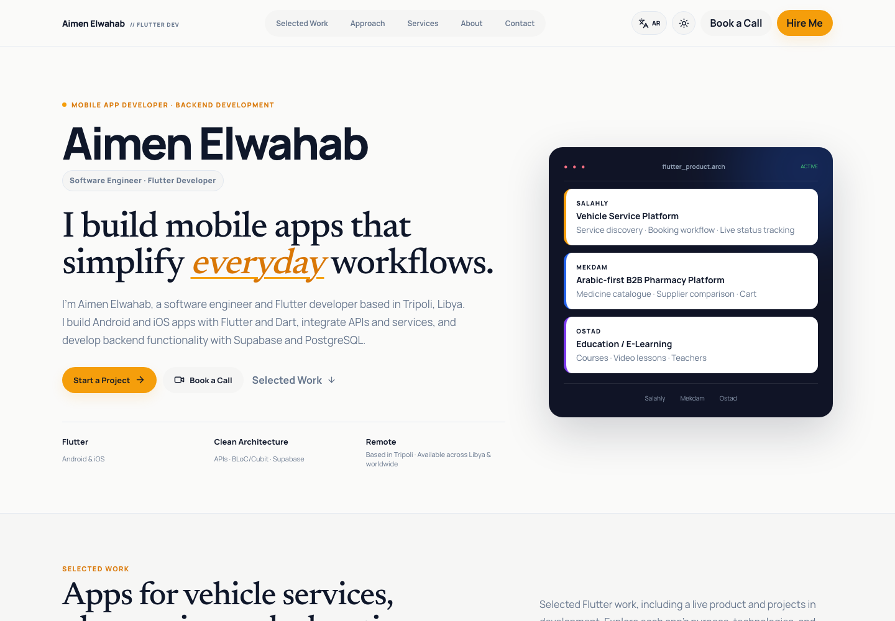
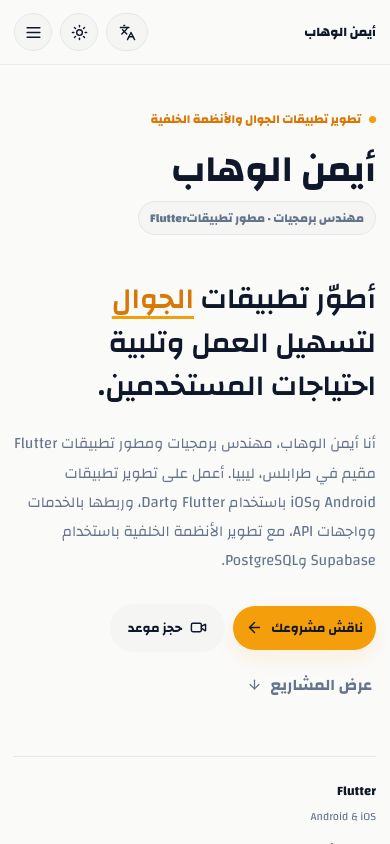

<div align="center">

# Aimen Elwahab · Portfolio

**Software Engineer & Flutter Developer · Tripoli, Libya**

A bilingual portfolio showcasing mobile applications, engineering expertise, and project case studies. Built with Next.js, React, and TypeScript, with full Arabic RTL support and an optional Supabase content dashboard.

[Live Website](https://aimen.ly) · [English](https://aimen.ly/en) · [العربية](https://aimen.ly/ar) · [Contact](mailto:aimenelwhab@gmail.com)


</div>



## Features

- **English and Arabic** — localized content, language switching, and RTL layouts.
- **Project case studies** — Salahly, Mekdam, and Ostad, with screenshot galleries and a full-screen image viewer.
- **Expertise pages** — Flutter development, Supabase and API integration, and UI implementation.
- **Responsive interface** — desktop, tablet, and mobile layouts with light, dark, and system themes.
- **Contact and booking** — email, phone, social profiles, and Google Calendar appointments.
- **Content dashboard** — manage project details, media, contact information, and SEO through `/admin` when Supabase is configured.
- **Search metadata** — localized titles, canonical URLs, language alternates, social previews, XML sitemap, and JSON-LD structured data.
- **Accessibility** — semantic headings, keyboard controls, reduced-motion support, and descriptive image text.

<details>
<summary><strong>Arabic mobile preview</strong></summary>



</details>

## Tech stack

| Layer | Technology |
| --- | --- |
| Application | Next.js 15 App Router, React 19, TypeScript |
| Styling | Custom CSS, responsive layouts, theme variables |
| Icons | Lucide React |
| Content management | Supabase Auth, PostgreSQL, Storage, and row-level security |
| SEO | Next.js Metadata API, sitemap, robots, and structured data |
| Verification | TypeScript, content audits, optional Playwright browser checks |

## Getting started

Use **Node.js 22 LTS** and npm.

```bash
git clone https://github.com/aimen94/aimen-portfolio.git
cd aimen-portfolio
npm ci
npm run dev
```

Open [localhost:3000](http://localhost:3000). The root redirects to `/en`; Arabic is available at `/ar`.

The public portfolio runs with built-in content and does not require environment variables. To enable the CMS, follow the setup below.

### Production build

```bash
npm run build
npm start
```

Use a separate checkout when running a development server and production build at the same time; both use `.next`.

## Content management

The default content lives in:

- [`data/default-content.ts`](data/default-content.ts) — bilingual portfolio copy, projects, contact details, and settings.
- [`data/expertise.ts`](data/expertise.ts) — expertise pages and related project links.
- [`public/images`](public/images) — project screenshots.
- [`public/og`](public/og) — social preview imagery.

### Enable the Supabase dashboard

1. Create a Supabase project and run [`supabase/portfolio-cms.sql`](supabase/portfolio-cms.sql) in its SQL editor.
2. Create your administrator account in Supabase Authentication.
3. Add that account to the administrator table:

   ```sql
   insert into public.portfolio_admins (user_id)
   select id from auth.users where email = 'you@example.com'
   on conflict (user_id) do nothing;
   ```

4. Copy the environment template:

   ```bash
   cp .env.example .env.local
   ```

5. Set your project URL and public anon key:

   ```dotenv
   NEXT_PUBLIC_SUPABASE_URL=https://your-project.supabase.co
   NEXT_PUBLIC_SUPABASE_ANON_KEY=your-public-anon-key
   ```

6. Restart the development server and sign in at `/admin`.

The dashboard supports bilingual content editing, image uploads, contact links, booking settings, and project metadata. Published Supabase content takes precedence over repository defaults. Expertise pages remain in source control.

Use the public anon key in browser configuration; keep service-role keys and `.env.local` out of the repository.

### Optional configuration

See [`.env.example`](.env.example) for booking, contact, and search-engine verification settings. Configure the same values in your hosting environment when enabling these features in production.

## Routes

| Route | Purpose |
| --- | --- |
| `/en`, `/ar` | Localized homepages |
| `/{locale}/projects/{id}` | Project case studies |
| `/{locale}/expertise/{slug}` | Expertise pages |
| `/admin` | Content dashboard |
| `/sitemap.xml` | Public page sitemap |
| `/robots.txt` | Crawler directives |

Supported locales are `en` and `ar`. The public sitemap includes 14 localized pages.

## Project structure

```text
app/          Routes, page metadata, layouts, and global styles
components/   Portfolio sections, navigation, galleries, and dashboard
data/        Default portfolio content and expertise definitions
lib/          Content loading, Supabase clients, SEO, and measurement
public/       Screenshots and social preview assets
scripts/      Content, browser, and performance checks
supabase/     Database schema and access policies
types/        Shared TypeScript types
docs/         Screenshots and technical documentation
```

## Verification

```bash
npm run typecheck
npm run audit
npm run build
npm audit
```

`npm run audit` checks translations, project media, content consistency, and JSON-LD serialization. `npm audit` checks dependency vulnerabilities.

To check rendered pages, start the production server, then run:

```bash
npm run audit -- http://localhost:3000
```

Browser and performance scripts require Playwright with Chromium available separately from the production dependencies:

```bash
npm run audit:browser -- http://localhost:3000
npm run audit:performance -- http://localhost:3000 docs/seo/performance-local.json
```

Set `PLAYWRIGHT_MODULE` to the installed Playwright module path if it is outside the project. Browser checks cover both languages, responsive layouts, image loading, language switching, menus, themes, and form validation.

## Deployment

The live portfolio is available at **[aimen.ly](https://aimen.ly)**. This repository contains the Next.js application and can be built on a host that supports Next.js server rendering.

Configure the production domain, environment variables, and HTTPS in the hosting provider. The current canonical domain is `aimen.ly`. Updating this GitHub repository does not automatically publish to the existing website.

## Contact

**Aimen Elwahab** · Software Engineer & Flutter Developer

[Website](https://aimen.ly) · [GitHub](https://github.com/aimen94) · [LinkedIn](https://www.linkedin.com/in/aimen-elwahab-651775181/) · [Email](mailto:aimenelwhab@gmail.com)
